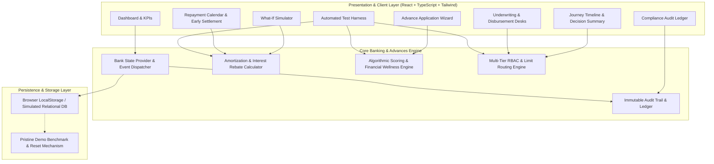
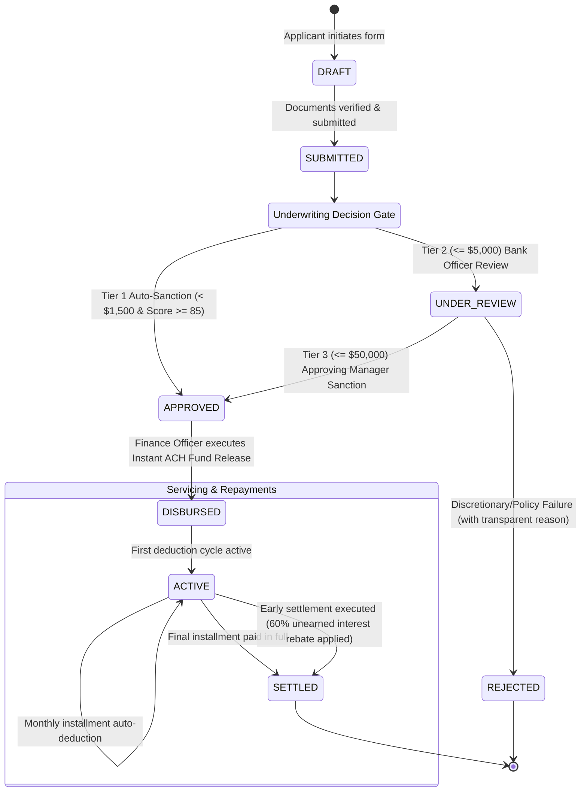

# Nexora Bank | System Design & Smart Advances Architecture

Nexora Bank is an original, institutional-grade banking application designed around a signature **Smart Advances Management System**. This document outlines the system architecture, domain models, multi-tier underwriting state machine, security controls, and testing framework.

---

## 1. System Architecture & Component Topology

---

## 2. Multi-Tier Advance Lifecycle State Machine

Each advance progresses through strict, role-gated state transitions with automated limit routing:

---

## 3. Relational Database Schema Design

The data model reflects institutional banking requirements:

### `users`
| Column | Type | Description |
| :--- | :--- | :--- |
| `id` | `VARCHAR(36)` PRIMARY KEY | Unique user identifier |
| `name` | `VARCHAR(100)` | Full legal name |
| `email` | `VARCHAR(120)` UNIQUE | Verified corporate/personal email |
| `role` | `ENUM(...)` | `customer`, `bank_officer`, `approving_manager`, `finance_officer`, `admin`, `auditor` |
| `monthly_income` | `DECIMAL(12, 2)` | Verified monthly net salary |
| `credit_score` | `INT` | Bureau credit rating (300 - 850) |
| `kyc_verified` | `BOOLEAN` | Level 3 KYC compliance flag |
| `approval_limit` | `DECIMAL(12, 2)` | Maximum discretionary signoff threshold |

### `advances`
| Column | Type | Description |
| :--- | :--- | :--- |
| `id` | `VARCHAR(36)` PRIMARY KEY | Internal facility ID |
| `application_no` | `VARCHAR(20)` UNIQUE | Display application code (e.g. `ADV-2026-0841`) |
| `user_id` | `VARCHAR(36)` FK | Link to `users.id` |
| `purpose` | `ENUM(...)` | `SALARY_ADVANCE`, `EQUIPMENT_PURCHASE`, `MEDICAL_EMERGENCY`, etc. |
| `requested_amount` | `DECIMAL(12, 2)` | Principal amount applied for |
| `approved_amount` | `DECIMAL(12, 2)` | Final amount sanctioned by officer |
| `tenure_months` | `INT` | Duration in months (1 - 24) |
| `interest_rate_annual` | `DECIMAL(5, 2)` | Fixed APR percentage (e.g. 4.50%) |
| `processing_fee` | `DECIMAL(10, 2)` | Upfront statutory closing fee (1%) |
| `monthly_installment` | `DECIMAL(10, 2)` | Standard equal monthly installment (PMT) |
| `repayment_method` | `ENUM(...)` | `SALARY_DEDUCTION`, `DIRECT_DEBIT`, `MANUAL_TRANSFER` |
| `status` | `ENUM(...)` | `DRAFT`, `SUBMITTED`, `UNDER_REVIEW`, `APPROVED`, `REJECTED`, `DISBURSED`, `ACTIVE`, `SETTLED` |
| `eligibility_score` | `INT` | Algorithmic scoring result (0 - 100) |
| `outstanding_principal` | `DECIMAL(12, 2)` | Unpaid principal balance |
| `outstanding_total` | `DECIMAL(12, 2)` | Total remaining dues (Principal + Interest) |

### `repayment_installments`
| Column | Type | Description |
| :--- | :--- | :--- |
| `id` | `VARCHAR(36)` PRIMARY KEY | Installment record ID |
| `advance_id` | `VARCHAR(36)` FK | Reference to parent `advances.id` |
| `installment_no` | `INT` | Sequential installment index (1..n) |
| `due_date` | `DATE` | Scheduled collection deadline |
| `principal_component` | `DECIMAL(10, 2)` | Principal amortization component |
| `interest_component` | `DECIMAL(10, 2)` | Interest revenue component |
| `fee_component` | `DECIMAL(10, 2)` | Ancillary fees |
| `total_due` | `DECIMAL(10, 2)` | Total amount payable |
| `amount_paid` | `DECIMAL(10, 2)` | Actual payment recorded |
| `status` | `ENUM(...)` | `PAID`, `UPCOMING`, `DUE`, `OVERDUE`, `WAIVED` |
| `transaction_ref` | `VARCHAR(40)` | External payment clearing trace reference |

### `audit_logs`
| Column | Type | Description |
| :--- | :--- | :--- |
| `id` | `VARCHAR(36)` PRIMARY KEY | Immutable entry ID |
| `timestamp` | `TIMESTAMP` | ISO 8601 atomic timestamp |
| `user_id` | `VARCHAR(36)` | Actor identifier |
| `action` | `VARCHAR(50)` | Action event code (e.g. `MANAGER_APPROVAL_GRANTED`) |
| `entity_type` | `VARCHAR(30)` | Target entity (`ADVANCE`, `ACCOUNT`, `CONFIG`) |
| `entity_id` | `VARCHAR(40)` | Specific target entity code |
| `ip_address` | `VARCHAR(45)` | Source network address |
| `details` | `TEXT` | Plaintext explanation of the event |
| `metadata` | `JSON` | Complete serialized JSON snapshot |

---

## 4. Key Financial Calculations & Transparency Guardrails

### Equal Monthly Installment (PMT) Formula
$$\text{PMT} = \frac{P \cdot r \cdot (1 + r)^n}{(1 + r)^n - 1}$$
Where:
- $P$ = Principal advance amount
- $r$ = Monthly interest rate ($\frac{\text{Annual APR}}{12}$)
- $n$ = Tenure in months

### Early Settlement Interest Rebate Formula
When a customer pays off an advance early, unaccrued future interest is calculated, and a statutory rebate discount (default 60%) is deducted from their settlement figure:
$$\text{Rebate Discount} = \sum_{k = m + 1}^{n} \text{Interest}_k \times \text{RebatePct}$$
$$\text{Net Payoff} = \text{Remaining Principal} + \left(\sum_{k = m + 1}^{n} \text{Interest}_k - \text{Rebate Discount}\right) + \text{Prepayment Fee ($0)}$$

---

## 5. Verification & Automated Test Results

The platform includes a built-in automated test suite executing 7 comprehensive test scenarios verifying:
- ✅ PMT calculation accuracy
- ✅ Early settlement rebate computation
- ✅ Income-to-advance ceiling enforcement (3.5x cap)
- ✅ Credit score tier weighting (Prime >= 720)
- ✅ Approval limit threshold routing (Officer vs. Manager)
- ✅ RBAC authorization restrictions for fund disbursement
- ✅ Zero-balance terminal settlement validation
